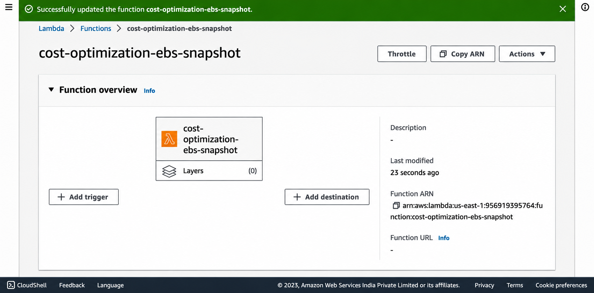
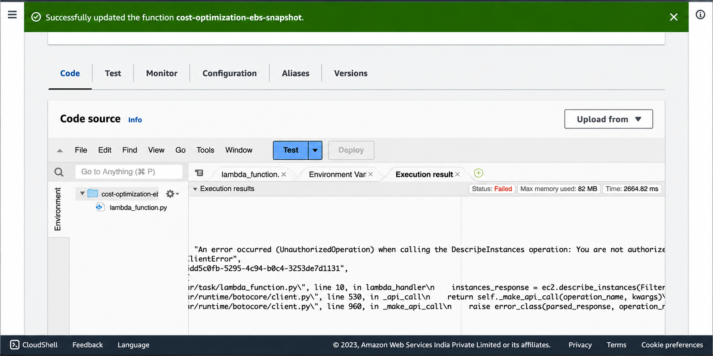
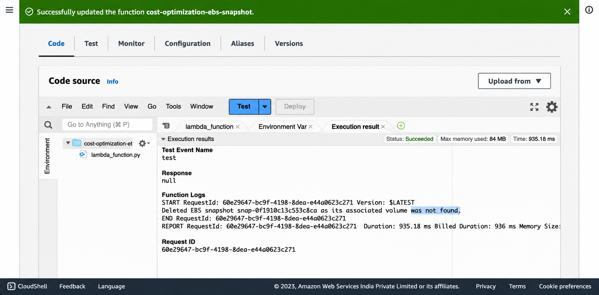
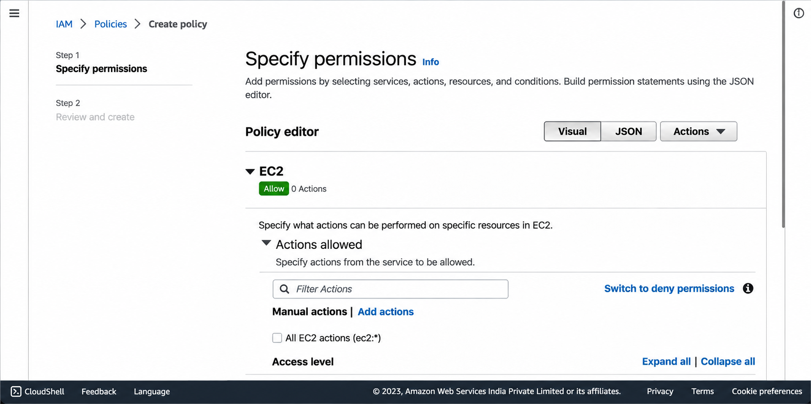
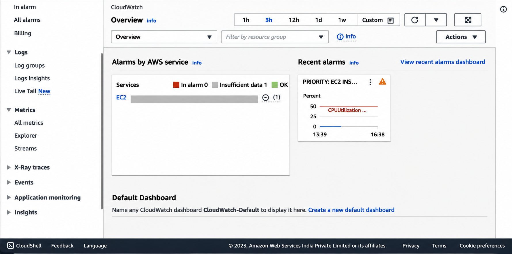
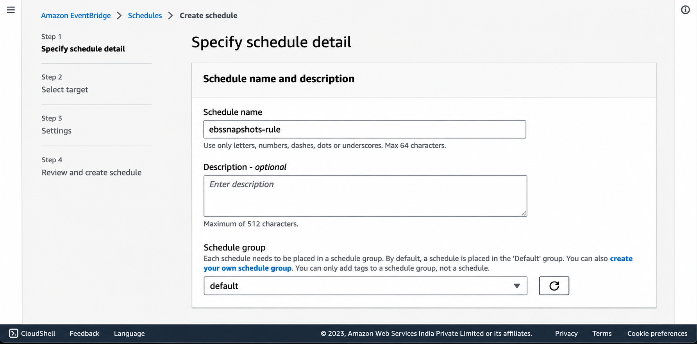

# AWS Cloud Cost Optimization – Automated EBS Snapshot Cleanup

## Project Overview
This project demonstrates automated AWS cost optimization by identifying and deleting stale Amazon EBS snapshots using AWS Lambda, Python, and Boto3.

The Lambda function checks whether snapshots are associated with existing EBS volumes or active EC2 instances and removes snapshots identified as stale according to the cleanup logic.

## Technologies Used
- AWS Lambda
- Python and Boto3
- Amazon EC2 and EBS
- Amazon EventBridge
- AWS IAM
- Amazon CloudWatch Logs

## How It Works
1. Amazon EventBridge triggers the Lambda function on a configured schedule.
2. Lambda uses Boto3 to retrieve EBS snapshot information.
3. The function checks related volumes and EC2 instance states.
4. Snapshots meeting the configured cleanup conditions are deleted.
5. Execution results are reviewed through Lambda test output and CloudWatch logs.

## Implementation Screenshots

### AWS Lambda Function

### Lambda Test Execution

### IAM Permissions

### CloudWatch Logs

### EventBridge Schedule

## Learning Outcomes
- Practiced AWS serverless automation with Lambda and Boto3.
- Configured IAM permissions for EC2/EBS resource inspection and snapshot deletion.
- Used EventBridge for scheduled execution.
- Tested automated snapshot cleanup and reviewed execution results.

## Acknowledgment
This hands-on project was implemented by following Abhishek Veeramalla's AWS DevOps Zero to Hero tutorial (Day 18). The original tutorial and sample code are credited to their author.

Original repository: https://github.com/iam-veeramalla/aws-devops-zero-to-hero/tree/main/day-18
